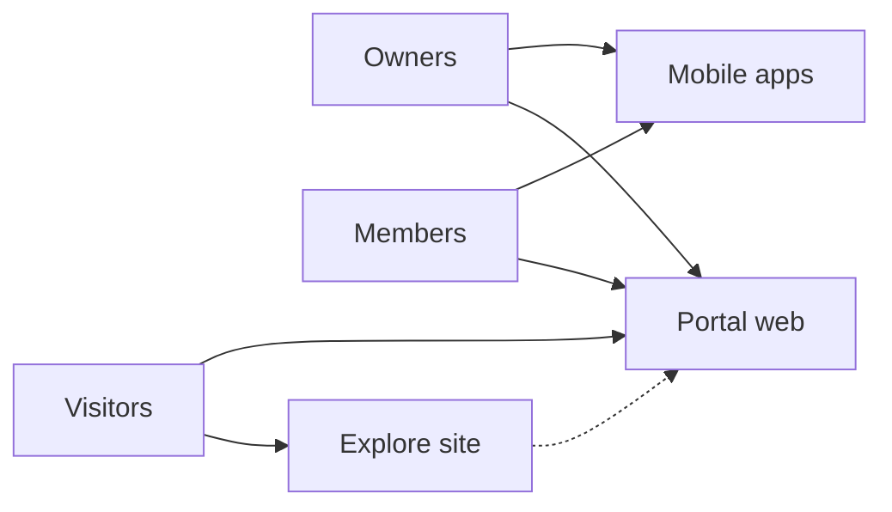

# Rockae

**Hosted communities** for creators, educators, and groups — forums, classrooms, events, chat, and monetization in one place. No API keys or backend URLs here; this page is the public face of the org. Technical docs live in [Documentation](https://github.com/MyRockae/Documentation).

## Get started

| | |
|--|--|
| **Run your community** | [rockae.com](https://rockae.com/) — sign up, create or join communities, owner and member tools on web |
| **Discover communities** | [explore.rockae.com](https://explore.rockae.com/) — marketing and discovery |
| **On the go** | Rockae mobile app (iOS and Android) — same communities, tuned for members and owners |

## Who Rockae is for

| | |
|--|--|
| **Community owners** | Launch a space, set tiers and access, publish content, invite members, and optionally charge for groups, events, or store products |
| **Members** | Learn, discuss, chat, and take part in classrooms, journeys, quizzes, polls, and events |
| **Visitors** | Preview communities and join when ready |

Platform operations (support, analytics, finance) use a separate **staff admin** application — not the public portal.

## What communities can include

- **Conversation** — forums, town hall, community blog, public feeds  
- **Learning** — classrooms, lessons, learning journeys, resources, quizzes  
- **Engagement** — polls, meetings, real-time chat, badges, optional engagement insights for managers  
- **Monetization** — free or paid access tiers, subscriptions, digital store, paid events  
- **Management** — roles (owner, co-owner, moderator, member), moderation, Telegram notifications where enabled  

## How the product fits together

Behind the scenes, Rockae is built as a **modular platform** (web and mobile clients, shared data, payment and messaging services). Architecture and requirements for contributors: [MyRockae/Documentation](https://github.com/MyRockae/Documentation).

## Open source

We welcome issues, discussions, and pull requests across our repositories.

- **Product documentation** — [Documentation](https://github.com/MyRockae/Documentation) (BRD, PRD, system design, repo catalog)  
- **Portal (web)** — [CommunityBuilder.PortalApp](https://github.com/MyRockae/CommunityBuilder.PortalApp)  
- **Mobile** — [CommunityBuilder.MobileApp](https://github.com/MyRockae/CommunityBuilder.MobileApp)  
- **All repositories** — [github.com/orgs/MyRockae/repositories](https://github.com/orgs/MyRockae/repositories)

## Connect

- **Website** — [rockae.com](https://rockae.com)  
- **Explore** — [explore.rockae.com](https://explore.rockae.com)  
- **Discussions** — use GitHub Discussions on the repo you are contributing to  

Thanks for visiting — happy community building.
