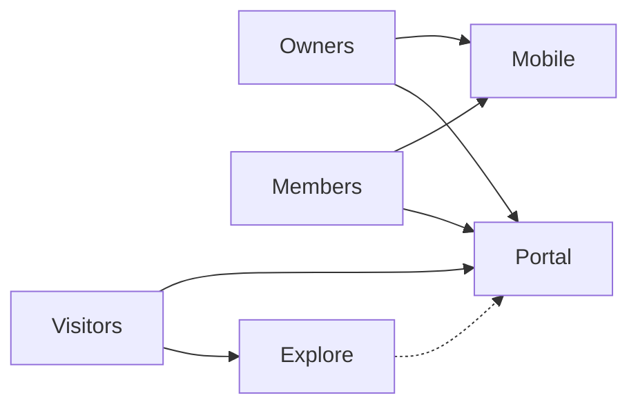

# Rockae

**Where communities belong.**

Feeds get noisy. Group chats disappear. Courses sit in one app, events in another, and the people who actually show up never quite meet in the same room. Rockae exists because **belonging needs a home** — a place you own, shape, and grow with the people who care.

We build software for that home: hosted communities with real conversation, learning, events, and (when you want it) a path to sustainability.

---

## Why communities still win

The best things we learn, build, and believe together rarely happen in isolation. They happen when someone asks a good question in a forum, when a cohort finishes a lesson the same week, when a member stays after the meeting because the chat is still warm.

Communities are not a feature. They are **infrastructure for trust** — and Rockae is our bet that creators, educators, teams, and friends deserve tools that respect that, not flatten it into a single feed.

---

## What you can do on Rockae

| | |
|--|--|
| **Start or join** | [rockae.com](https://rockae.com/) — create a community, invite members, or find one that fits you |
| **Discover** | [explore.rockae.com](https://explore.rockae.com/) — browse what is out there before you commit |
| **Take it with you** | Mobile apps for members and owners who live on their phone |

Inside a community you might run **forums and town hall**, **classrooms and learning journeys**, **polls, quizzes, and events**, **real-time chat**, **blogs and resources**, and **tiers or paid access** when the owner is ready to monetize. You choose the mix; the platform holds the space.

---

## Read the story on our blog

Product updates, community-building ideas, and the occasional behind-the-scenes note — **our blog is where we talk like humans**, not release notes.

**[rockae.com/blog](https://rockae.com/blog)** — grab a coffee and scroll. If you have just landed from GitHub, start there to see what we are building and why.

---

## Build with us (and have a say)

This org is open. We ship in public repos, but the **conversation** happens in [**MyRockae Discussions**](https://github.com/orgs/MyRockae/discussions) — announcements, ideas, questions, show-and-tell. That is the front door if you want to contribute, suggest a feature, or meet the people behind the code.

| Want to… | Go here |
|----------|---------|
| **Talk to the team and community** | [**github.com/orgs/MyRockae/discussions**](https://github.com/orgs/MyRockae/discussions) |
| **Understand the platform (BRD, architecture, repos)** | [Documentation](https://github.com/MyRockae/Documentation) |
| **Browse or fork code** | [Portal](https://github.com/MyRockae/CommunityBuilder.PortalApp) · [Mobile](https://github.com/MyRockae/CommunityBuilder.MobileApp) · [all repos](https://github.com/orgs/MyRockae/repositories) |

Open an issue when something breaks. Start a discussion when something *should* exist. We would rather hear you early than guess in a vacuum.

---

## A small team, a big room

We are building Rockae because we have seen what happens when community builders get generic tools and members get friction. We want the opposite: **less setup, more presence, room to grow.**

Thanks for stopping by on GitHub. If this resonated, say hi in [Discussions](https://github.com/orgs/MyRockae/discussions) — or go start something real at [rockae.com](https://rockae.com/).
